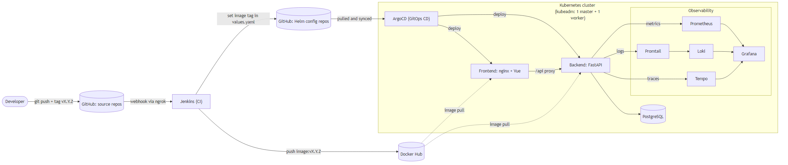

# VDT DevOps — CI/CD & Cloud Observability for a Student Management Web System

This repository applies a **CI/CD pipeline with GitOps** and a **Cloud Observability** stack to deploy and operate a small web application on a self-managed **Kubernetes** cluster.

The application is a **Student Management** system:

| Layer    | Technology                               | Notes                                                                 |
|----------|------------------------------------------|-----------------------------------------------------------------------|
| Frontend | Vue 3 + Vite, served by **nginx**        | nginx also reverse-proxies `/api/*` to the backend service            |
| Backend  | **FastAPI** (Python 3.11), SQLAlchemy async | JWT auth (`admin` / `user` roles), CRUD on students, rate limiting |
| Database | **PostgreSQL 15**                        | Initialized from [db.sql](https://github.com/duyanh221204/vdt-backend-config/blob/main/db.sql)                    |

## Architecture



- **CI (Jenkins):** a Git tag `vX.Y.Z` on a source repo triggers a pipeline. It builds the Docker image with the **Git tag as the image tag**, pushes it to Docker Hub, and commits that tag into the matching Helm config repo.
- **CD (ArgoCD, GitOps):** ArgoCD watches the config repos and automatically syncs the cluster to what is in Git.
- **Observability:** Prometheus (metrics), Loki + Promtail (logs) and Tempo + OpenTelemetry (traces), all visualized and **correlated** in Grafana.

## Repository layout

This is an umbrella repository; every component lives in its own Git repository, included as a **submodule**.

| Path | Repository | Content |
|------|------------|---------|
| `app/src/backend` | [vdt-backend](https://github.com/duyanh221204/vdt-backend) | FastAPI source, `Dockerfile`, `Jenkinsfile` |
| `app/src/frontend` | [vdt-frontend](https://github.com/duyanh221204/vdt-frontend) | Vue source, `nginx.conf`, `Dockerfile`, `Jenkinsfile` |
| `app/helm/backend` | [vdt-backend-config](https://github.com/duyanh221204/vdt-backend-config) | Helm chart: backend + PostgreSQL + ServiceMonitor |
| `app/helm/frontend` | [vdt-frontend-config](https://github.com/duyanh221204/vdt-frontend-config) | Helm chart: frontend |
| `cloud-observability` | [vdt-cloud-observability](https://github.com/duyanh221204/vdt-cloud-observability) | ArgoCD apps + Helm values for Prometheus, Loki, Promtail, Tempo |
| [ci-cd](ci-cd) | *(this repo)* | Manifests for ArgoCD, Jenkins and the ArgoCD Applications |
| [scripts](scripts) | *(this repo)* | Helper scripts used by the docs |
| [docs](docs) | *(this repo)* | Step-by-step setup guide |

Clone everything at once:

```bash
git clone --recurse-submodules https://github.com/duyanh221204/vdt-devops.git
# or, in an existing clone
git submodule update --init --recursive
```

## Endpoints

All services are exposed as `NodePort` on every node. The ports are listed in [docs/README.md](docs/README.md#exposed-services).

## Documentation

Start with **[docs/README.md](docs/README.md)**: it describes the environment and links to each step in order:

1. [Kubernetes cluster](docs/1-kubernetes-cluster.md)
2. [ArgoCD, first deployment and Jenkins](docs/2-argocd-and-jenkins.md)
3. [CI/CD pipeline](docs/3-ci-cd-pipeline.md)
4. [Cloud observability setup](docs/4-cloud-observability-setup.md)
5. [Metrics, logs, traces and their correlation](docs/5-metrics-logs-traces.md)
