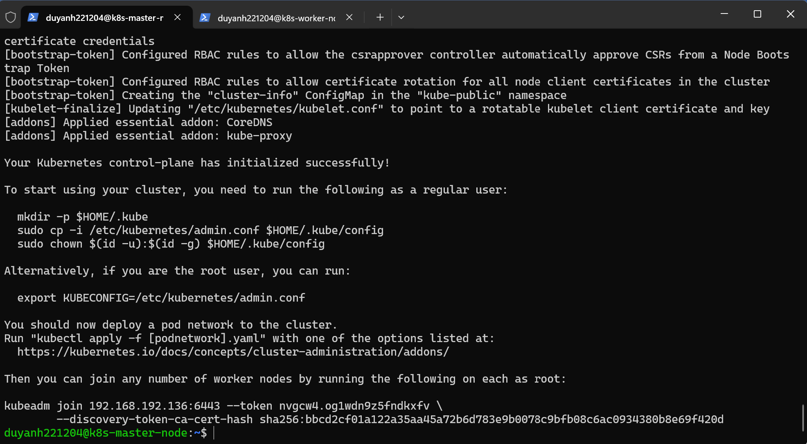
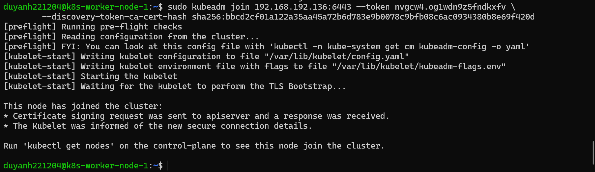
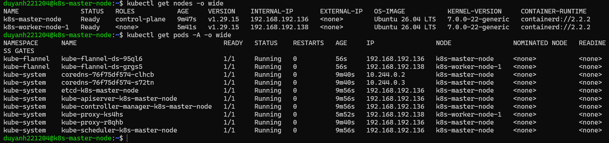

# 1. Kubernetes Cluster with kubeadm

The cluster is built with **kubeadm** on the two VMs described in the [overview](README.md#virtual-machines):

- `k8s-master-node` (`192.168.192.136`): control plane
- `k8s-worker-node-1` (`192.168.192.138`): runs all workloads

| Component | Choice |
|-----------|--------|
| Kubernetes | v1.29 (`kubeadm`, `kubelet`, `kubectl` from `pkgs.k8s.io`) |
| Container runtime | containerd, with the `systemd` cgroup driver |
| CNI (pod network) | Flannel, pod CIDR `10.244.0.0/16` |

## 1.1 Prepare both nodes

> Run on **both** the master and the worker.
> Script: [scripts/1-node-prepare.sh](../scripts/1-node-prepare.sh) (`sudo ./scripts/1-node-prepare.sh`)

### Disable swap

The kubelet refuses to start while swap is on, because swapping makes Pod memory limits and scheduling unpredictable.

```bash
sudo swapoff -a                     # turn swap off now
sudo rm -f /swap.img                # remove the swap file
sudo sed -i '/swap/d' /etc/fstab    # keep it off after reboot
```

### Kernel modules

- `overlay` is the filesystem used by containerd for container layers.
- `br_netfilter` lets iptables see traffic crossing the Linux bridge, which kube-proxy and Flannel rely on.

```bash
cat <<EOF | sudo tee /etc/modules-load.d/k8s.conf
overlay
br_netfilter
EOF

sudo modprobe overlay
sudo modprobe br_netfilter
```

### sysctl

Bridged traffic must go through iptables, and the node must forward IP packets between Pods and nodes:

```bash
cat <<EOF | sudo tee /etc/sysctl.d/k8s.conf
net.bridge.bridge-nf-call-iptables = 1
net.bridge.bridge-nf-call-ip6tables = 1
net.ipv4.ip_forward = 1
EOF

sudo sysctl --system
```

### containerd

```bash
sudo apt-get update
sudo apt-get install -y containerd

sudo mkdir -p /etc/containerd
containerd config default | sudo tee /etc/containerd/config.toml > /dev/null
sudo sed -i 's/SystemdCgroup = false/SystemdCgroup = true/g' /etc/containerd/config.toml
sudo systemctl restart containerd
sudo systemctl enable containerd
```

`SystemdCgroup = true` makes containerd use the same cgroup driver as the kubelet (`systemd`). If the two drivers differ, the node becomes unstable under resource pressure.

### kubeadm, kubelet, kubectl

```bash
sudo apt-get update
sudo apt-get install -y apt-transport-https ca-certificates curl gpg

sudo mkdir -p /etc/apt/keyrings
curl -fsSL https://pkgs.k8s.io/core:/stable:/v1.29/deb/Release.key \
  | sudo gpg --dearmor -o /etc/apt/keyrings/kubernetes-apt-keyring.gpg
echo 'deb [signed-by=/etc/apt/keyrings/kubernetes-apt-keyring.gpg] https://pkgs.k8s.io/core:/stable:/v1.29/deb/ /' \
  | sudo tee /etc/apt/sources.list.d/kubernetes.list

sudo apt-get update
sudo apt-get install -y kubelet kubeadm kubectl
sudo apt-mark hold kubelet kubeadm kubectl    # prevent unplanned upgrades
```

## 1.2 Initialise the control plane

> Run on the **master** as the normal user.
> Script: [scripts/1-master-init.sh](../scripts/1-master-init.sh)

```bash
sudo kubeadm init --pod-network-cidr=10.244.0.0/16
```

`--pod-network-cidr` must match the network Flannel uses by default (`10.244.0.0/16`).



At the end, `kubeadm init` prints a `kubeadm join ...` command. Keep it for step 1.3.

Configure `kubectl` for the current user:

```bash
mkdir -p $HOME/.kube
sudo cp -i /etc/kubernetes/admin.conf $HOME/.kube/config
sudo chown $(id -u):$(id -g) $HOME/.kube/config
```

Install the **Flannel** CNI. Until a CNI exists, Pods cannot get an IP, CoreDNS stays `Pending` and nodes stay `NotReady`:

```bash
kubectl apply -f https://github.com/flannel-io/flannel/releases/latest/download/kube-flannel.yml
```

## 1.3 Join the worker node

> Run on the **worker**, with `sudo`.

Use the command printed by `kubeadm init`:

```bash
sudo kubeadm join 192.168.192.136:6443 --token <token> \
        --discovery-token-ca-cert-hash sha256:<hash>
```

The bootstrap token expires after 24 hours. To get a fresh join command, run this on the master:

```bash
kubeadm token create --print-join-command
```



## 1.4 Verify

On the master:

```bash
kubectl get nodes -o wide
kubectl get pods -A -o wide
```

Both nodes are `Ready` (v1.29.15, containerd runtime). Flannel runs one Pod per node (`kube-flannel` namespace). CoreDNS has Pod IPs from `10.244.0.0/16`.



Next: [2. ArgoCD, first deployment and Jenkins](2-argocd-and-jenkins.md)
