# 2. ArgoCD, First Deployment and Jenkins

This step installs the two tools of the delivery chain and deploys the application for the first time:

- **ArgoCD**, the GitOps CD tool. It keeps the cluster in sync with the Helm config repos.
- The **backend and frontend**, deployed through ArgoCD from their Helm config repos.
- **Jenkins**, the CI tool. It can build Docker images by using the worker's Docker Engine.

All `kubectl` commands run on the **master** unless stated otherwise.

## 2.1 Prepare the worker node

> Run on the **worker**.
> Script: [scripts/2-worker-prepare.sh](../scripts/2-worker-prepare.sh) (`sudo ./scripts/2-worker-prepare.sh`)

Jenkins and PostgreSQL store their data in **hostPath** volumes, which are directories on the worker's disk. A hostPath is enough here because there is only one worker. Each directory must belong to the UID the container runs as:

```bash
sudo mkdir -p /data/jenkins_home
sudo chown -R 1000:1000 /data/jenkins_home    # user "jenkins" in jenkins/jenkins:lts

sudo mkdir -p /data/postgres_home
sudo chown -R 999:999 /data/postgres_home     # user "postgres" in postgres:15-alpine
```

**Docker Engine** is also installed on the worker. The Jenkins image has no Docker, so Jenkins builds images by talking to this engine through `/var/run/docker.sock` (see [2.5](#25-let-jenkins-build-docker-images)).

Install Docker **before** deploying Jenkins. Otherwise the socket does not exist yet, and the kubelet creates an empty directory in its place when it mounts the hostPath.

```bash
sudo apt-get update
sudo apt-get install -y docker.io
```

By default, only `root` and the `docker` group can use `docker.sock`, and its permissions are reset on every reboot. A systemd override makes the socket permanently readable and writable for everyone (`0666`), so the `jenkins` user (UID 1000) inside the pod can use it:

```bash
sudo mkdir -p /etc/systemd/system/docker.socket.d
sudo systemctl start docker.socket
echo -e "[Socket]\nSocketMode=0666" | sudo tee /etc/systemd/system/docker.socket.d/override.conf

sudo systemctl daemon-reload
sudo systemctl enable --now docker.socket
sudo systemctl enable --now docker
sudo systemctl restart docker.socket
sudo systemctl restart docker
```

> **Security note:** access to `docker.sock` is root-equivalent on the worker. This is acceptable for a lab cluster. A production setup would build images with a rootless builder instead, such as Kaniko or BuildKit.

## 2.2 ArgoCD

**GitOps** treats Git as the single source of truth: the desired state of the cluster is declared in Git. An agent *inside* the cluster pulls that state and keeps reconciling the cluster against it. **ArgoCD** is that agent.

Install it into its own namespace from the official manifest. `--server-side` is required because some ArgoCD CRDs are too large for a client-side apply.

```bash
kubectl create namespace argocd
kubectl apply -n argocd -f https://raw.githubusercontent.com/argoproj/argo-cd/stable/manifests/install.yaml --server-side
```

### Expose the UI with a NodePort

[ci-cd/argocd/argoCD.yaml](../ci-cd/argocd/argoCD.yaml) redefines the `argocd-server` Service as `NodePort`, with fixed ports **32001** (HTTP) and **32002** (HTTPS). Apply it:

```bash
kubectl apply -f ci-cd/argocd/argoCD.yaml
kubectl get services -n argocd
```

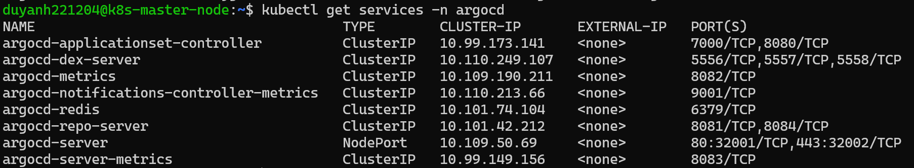

### Log in

The user is `admin`. The initial password is stored in a Secret:

```bash
kubectl -n argocd get secret argocd-initial-admin-secret -o jsonpath="{.data.password}" | base64 -d; echo
```

Open https://192.168.192.136:32002 and accept the self-signed certificate:

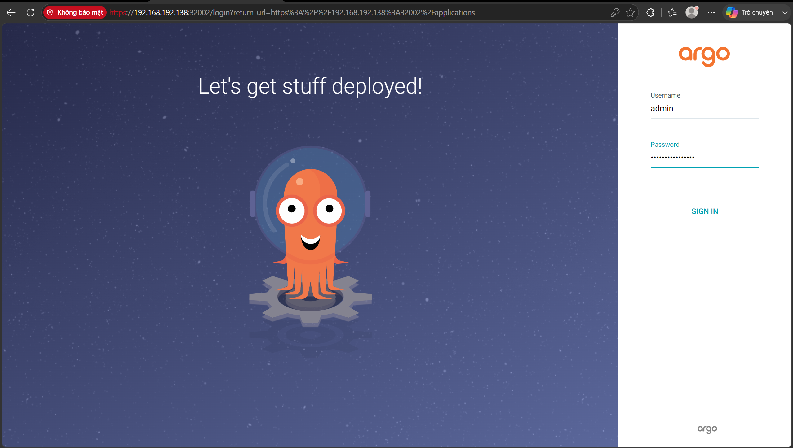

The ArgoCD dashboard after the first login, with no Application yet:

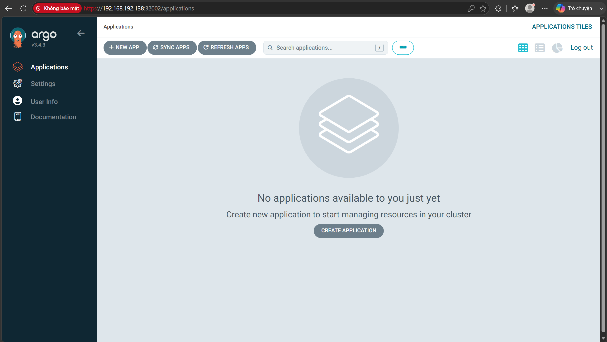

## 2.3 First deployment of the backend and frontend

### Initial images

The very first images are built and pushed by hand from the Windows host (Docker Desktop). After that, Jenkins does it (see [step 3](3-ci-cd-pipeline.md)). Run each command from the matching source folder:

```powershell
docker login
# app/src/backend
docker build -t nguyenduyanh221204/vdt-backend:v1.0.0 .
docker push nguyenduyanh221204/vdt-backend:v1.0.0
# app/src/frontend
docker build -t nguyenduyanh221204/vdt-frontend:v1.0.0 .
docker push nguyenduyanh221204/vdt-frontend:v1.0.0
```

Dockerfiles: [backend](https://github.com/duyanh221204/vdt-backend/blob/main/Dockerfile) (multi-stage, `uvicorn` on port 8000) and [frontend](https://github.com/duyanh221204/vdt-frontend/blob/main/Dockerfile) (Vite build, served by nginx with [nginx.conf](https://github.com/duyanh221204/vdt-frontend/blob/main/nginx.conf)).

### Helm config repos

Each app has a separate **config repo** that holds its Helm chart. ArgoCD watches these repos, not the source repos. This separates "what code exists" from "what runs in the cluster".

| Chart | Resources | Main settings |
|-------|-----------|---------------|
| [vdt-backend-config](https://github.com/duyanh221204/vdt-backend-config) | backend Deployment and NodePort Service; PostgreSQL Deployment and ClusterIP Service; PV/PVC (hostPath `/data/postgres_home`); ConfigMap with [db.sql](https://github.com/duyanh221204/vdt-backend-config/blob/main/db.sql) mounted into `/docker-entrypoint-initdb.d/`; ServiceMonitor (added in [step 4](4-cloud-observability-setup.md)) | [values.yaml](https://github.com/duyanh221204/vdt-backend-config/blob/main/values.yaml) |
| [vdt-frontend-config](https://github.com/duyanh221204/vdt-frontend-config) | frontend Deployment and NodePort Service | [values.yaml](https://github.com/duyanh221204/vdt-frontend-config/blob/main/values.yaml) |

The backend reaches the database through the `vdt-database-svc` Service. The DB credentials, JWT settings and OTLP endpoint are passed as environment variables from `values.yaml`.

> **Note:** `database.password` and `backend.auth.secretKey` are stored in plain text in `values.yaml`. This is acceptable for a lab. A real setup would keep them in a Kubernetes Secret managed outside Git, for example with Sealed Secrets or External Secrets.

The image version lives in one field, `image.tag`. It always holds a `vX.Y.Z` version, and from step 3 on it is updated by the CI pipeline with the release's **Git tag**, because the Git tag is used as the image tag.

### ArgoCD Applications

An ArgoCD **Application** connects a Git source (repo, revision, path) to a destination (cluster and namespace). With `syncPolicy.automated`:

- **`prune: true`** deletes resources that were removed from Git.
- **`selfHeal: true`** reverts manual changes made in the cluster.

The two Applications are [ci-cd/argocd/apps/vdt-backend-app.yaml](../ci-cd/argocd/apps/vdt-backend-app.yaml) and [ci-cd/argocd/apps/vdt-frontend-app.yaml](../ci-cd/argocd/apps/vdt-frontend-app.yaml). Both apps track `HEAD` of their config repo, path `.`, and deploy into the `default` namespace.

```bash
kubectl apply -f ci-cd/argocd/apps/vdt-backend-app.yaml
kubectl apply -f ci-cd/argocd/apps/vdt-frontend-app.yaml
```

Both applications become **Synced** and **Healthy**:

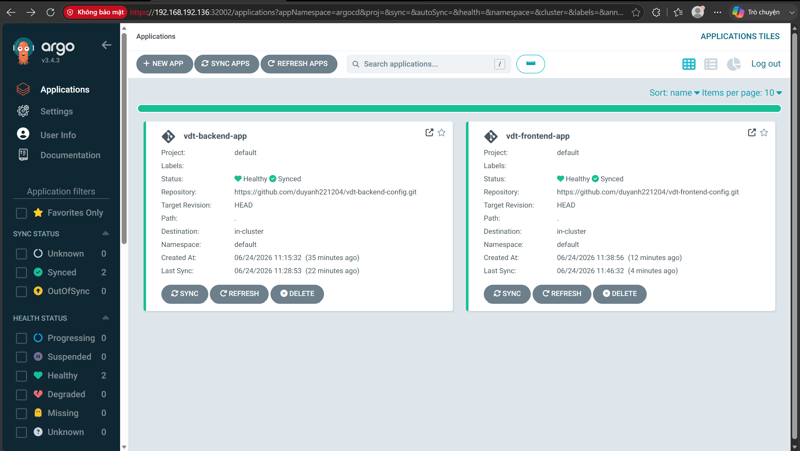

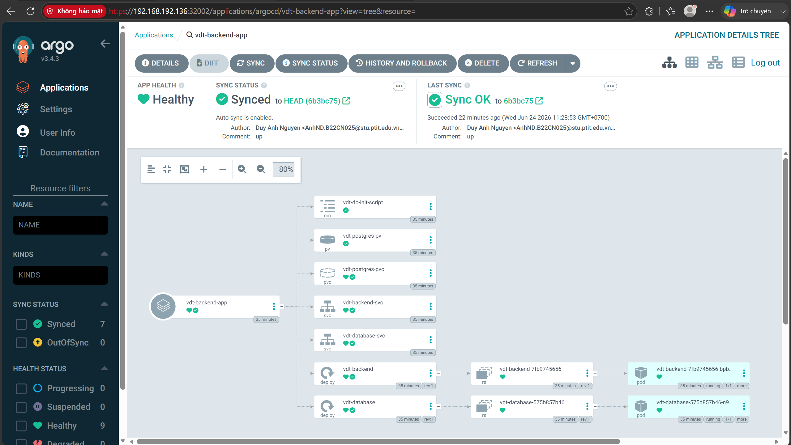

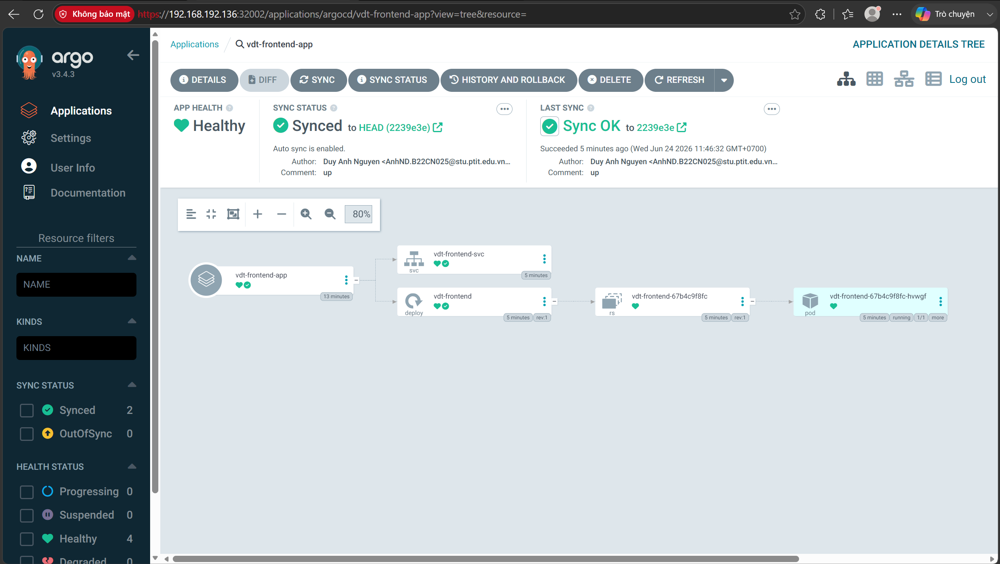

### Verify

Frontend at http://192.168.192.136:30001. The admin account is created by the backend at startup (`admin` / `admin`), and the student list comes from the database seed:

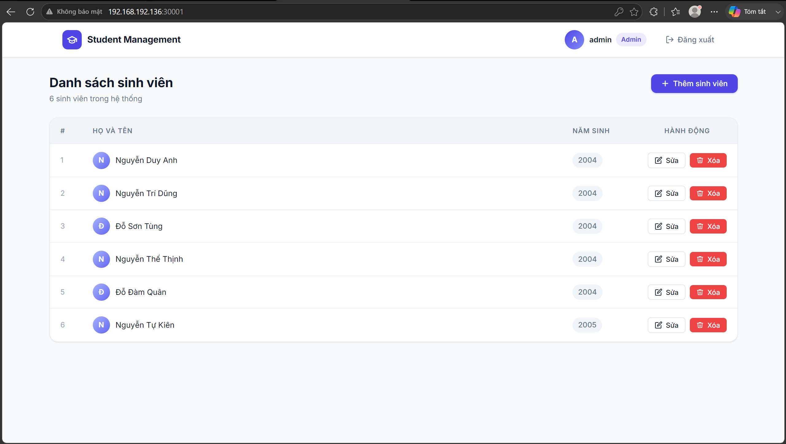

The Vue app calls the API with a **relative** base URL (`VITE_BASE_API_URL=/api`), so the browser sends `/api/...` to the frontend's own origin (`:30001`). nginx then **reverse-proxies** `/api/` to `http://vdt-backend-svc:8000/api/` inside the cluster. As a result, the backend URL is never hard-coded into the bundle and there is no CORS issue.

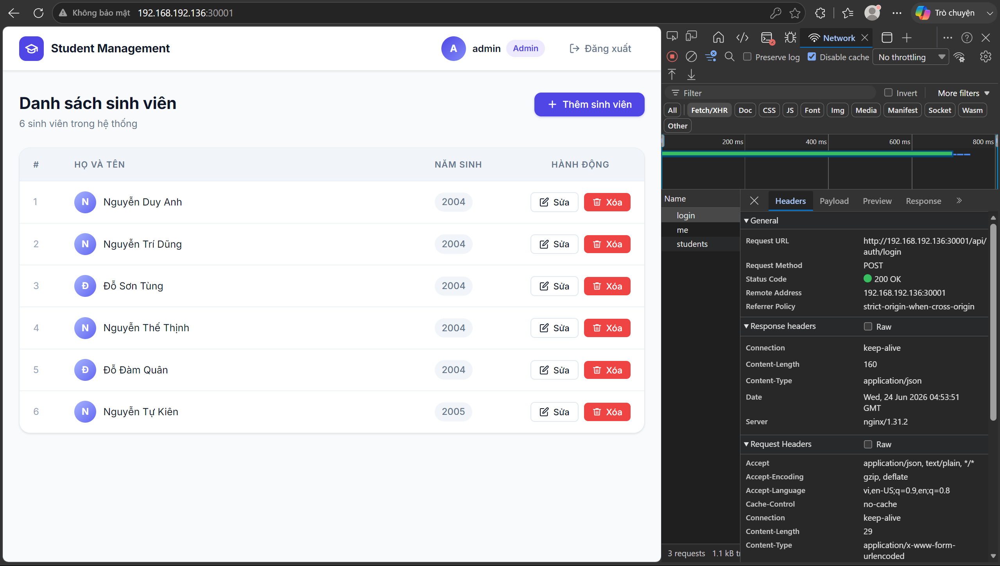

Backend Swagger UI at http://192.168.192.136:30000/docs:

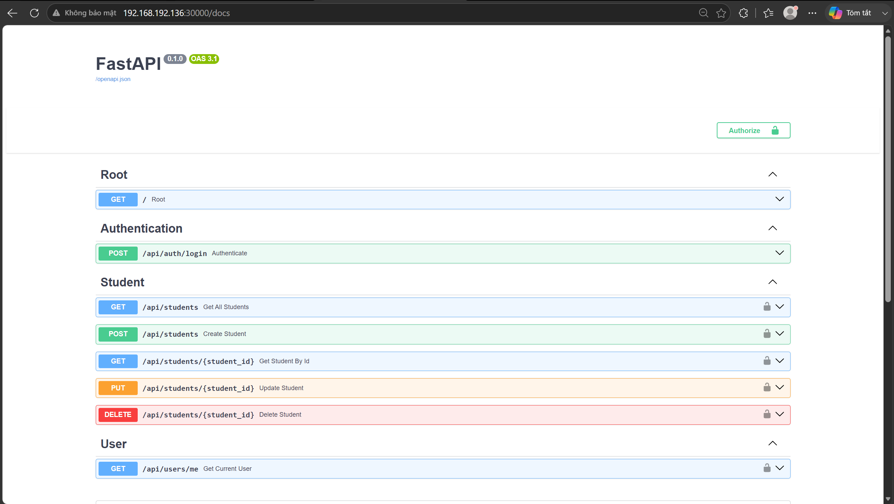

## 2.4 Jenkins

Jenkins runs as a Deployment in its own namespace. Its home directory (`/var/jenkins_home`) is on a PersistentVolume, so jobs, plugins and credentials survive Pod restarts.

```bash
kubectl create namespace jenkins
```

[ci-cd/jenkins/jenkins-pvc.yaml](../ci-cd/jenkins/jenkins-pvc.yaml) defines:

- a 10 Gi **PersistentVolume** backed by hostPath `/data/jenkins_home` (`storageClassName: manual`)
- a **PersistentVolumeClaim** `jenkins-pvc` in the `jenkins` namespace that binds to it

```bash
kubectl apply -f ci-cd/jenkins/jenkins-pvc.yaml
```

[ci-cd/jenkins/jenkins.yaml](../ci-cd/jenkins/jenkins.yaml) defines:

- **Deployment** `jenkins/jenkins:lts`, with `JAVA_OPTS="-Xms256m -Xmx512m"`. This caps the JVM heap at 512 MB so Jenkins cannot use up the worker's RAM.
- Mounts `jenkins-pvc` on `/var/jenkins_home`, and the worker's `/var/run/docker.sock` on the same path (used in [2.5](#25-let-jenkins-build-docker-images)).
- **Service** `NodePort` **32000**.

```bash
kubectl apply -f ci-cd/jenkins/jenkins.yaml
kubectl get services -n jenkins
```

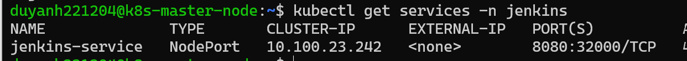

### Initial setup

Get the initial admin password from the logs. It is also stored in `/var/jenkins_home/secrets/initialAdminPassword`:

```bash
kubectl logs -n jenkins deployment/jenkins
```

Open http://192.168.192.136:32000 and paste the password:

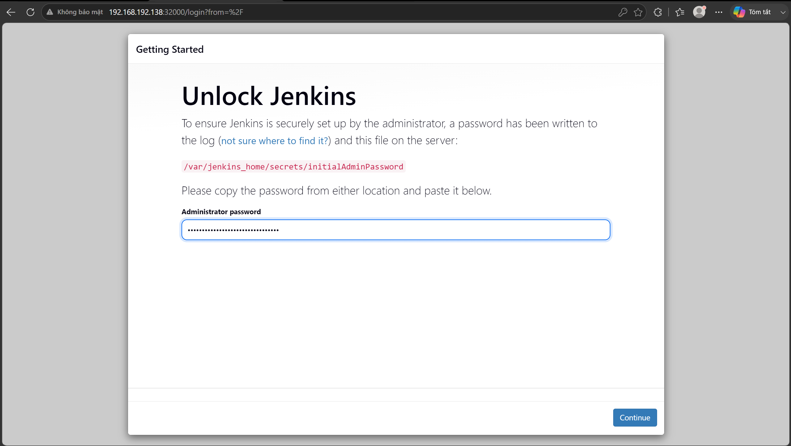

Then:

1. Choose **Install suggested plugins**. These include Git, Pipeline, GitHub, Credentials Binding and Workspace Cleanup, which the pipelines need.
2. Create the admin user.
3. Keep the Jenkins URL.

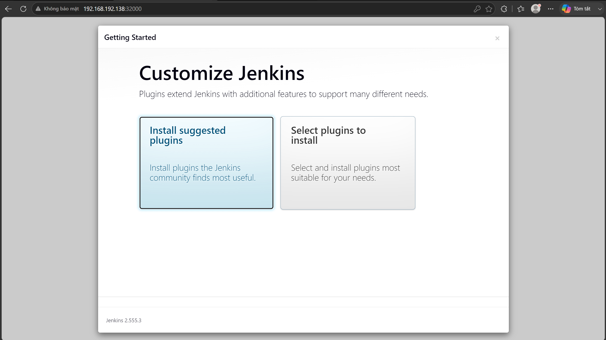

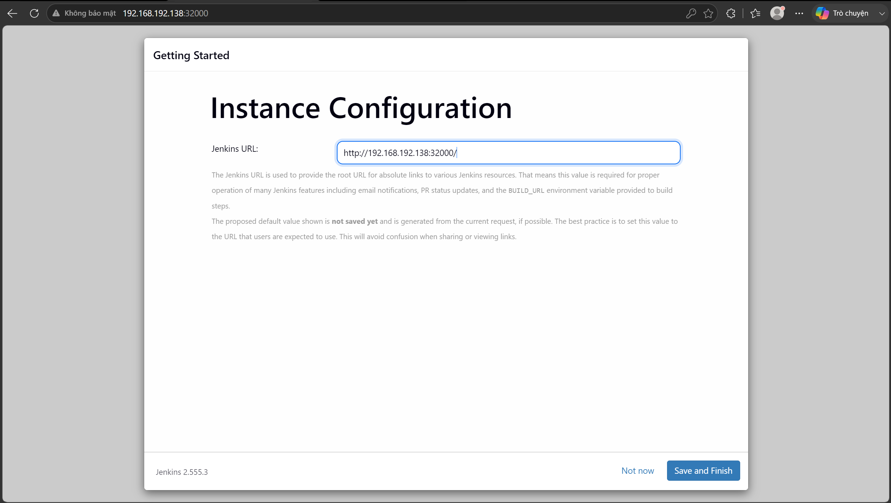

Then log in with the admin account:

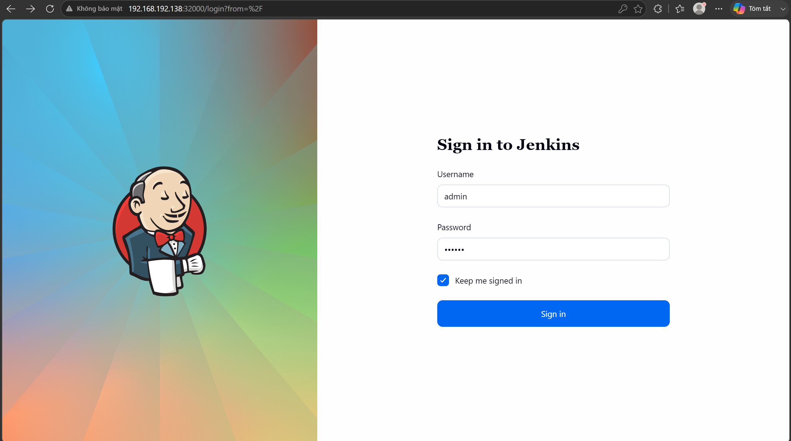

The dashboard is empty until the pipeline jobs are created in [step 3](3-ci-cd-pipeline.md#34-pipeline-jobs):

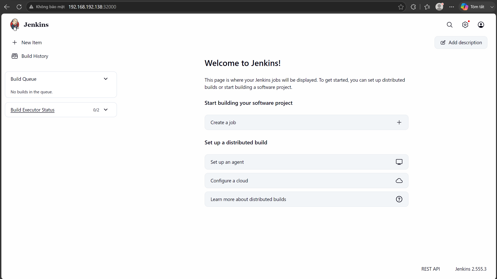

## 2.5 Let Jenkins build Docker images

The `docker.sock` mount only gives Jenkins a channel to the worker's Docker Engine. Jenkins still needs the `docker` **CLI**. The static binary is downloaded into `/var/jenkins_home`. Because that folder is on the PVC, the binary survives restarts, and the pipelines call it through `DOCKER_PATH = '/var/jenkins_home/docker'`.

> Run on the **master**.
> Script: [scripts/2-jenkins-docker-cli.sh](../scripts/2-jenkins-docker-cli.sh) (`./scripts/2-jenkins-docker-cli.sh`)

```bash
kubectl exec -it deployment/jenkins -n jenkins -- /bin/bash

# inside the Jenkins container
cd /var/jenkins_home
curl -fsSL https://download.docker.com/linux/static/stable/x86_64/docker-27.0.3.tgz -o docker.tgz
tar xzvf docker.tgz                       # creates ./docker/ (docker, containerd, runc, ...)
mv docker docker-folder                   # free the name "docker" for the binary
mv docker-folder/docker /var/jenkins_home/
chmod +x /var/jenkins_home/docker
rm -rf docker-folder docker.tgz
/var/jenkins_home/docker version          # Client + Server (the worker's engine) = OK
exit
```

Jenkins can now run `docker build` and `docker push`.

Next: [3. CI/CD pipeline](3-ci-cd-pipeline.md)
