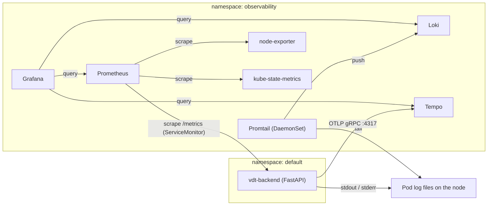
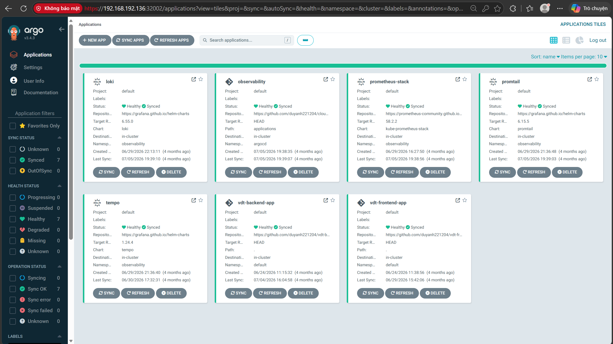
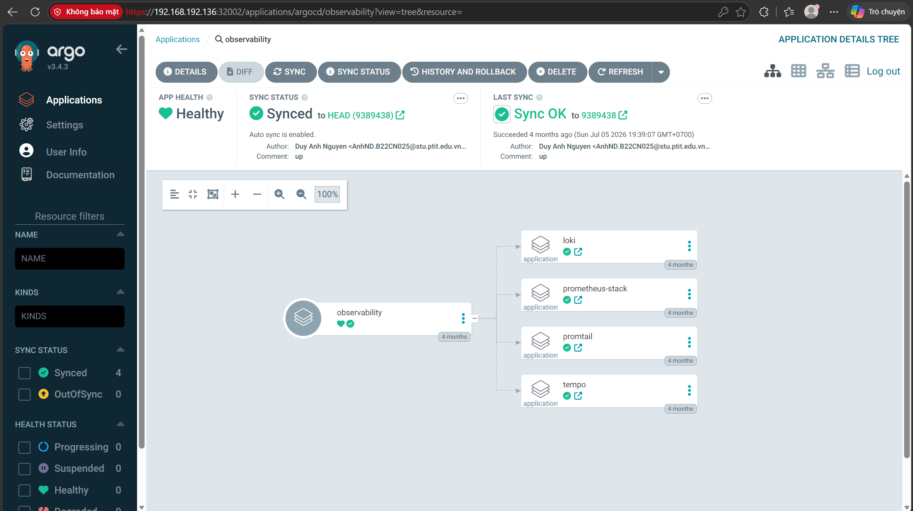
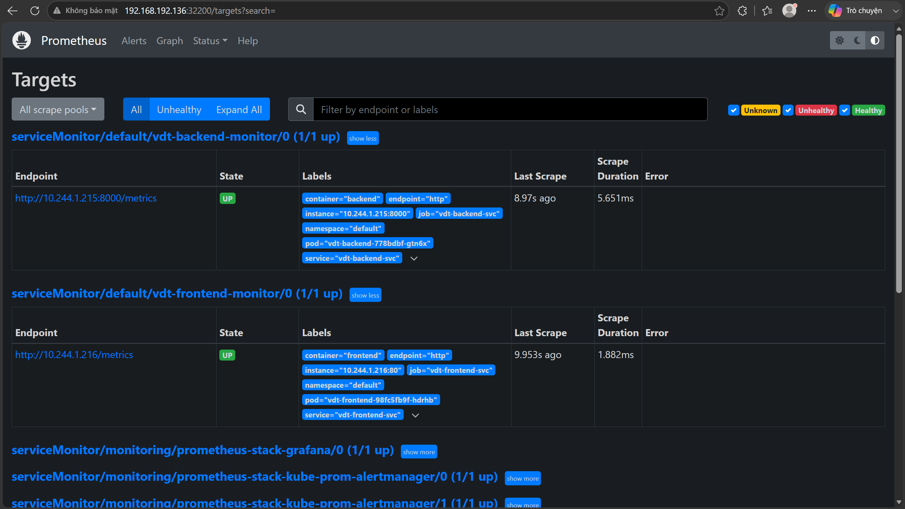
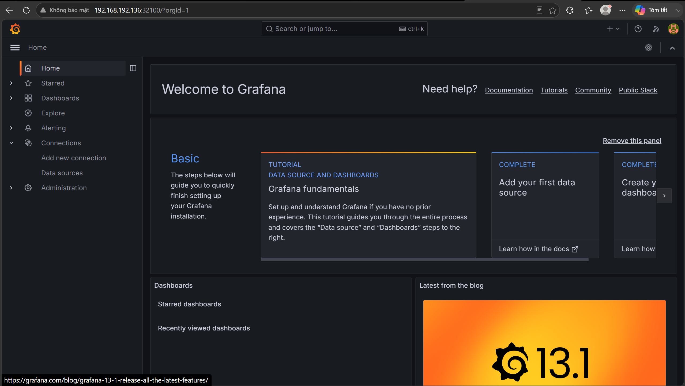

# 4. Cloud Observability Setup

This step deploys the observability stack. It is deployed **the GitOps way**, like the applications: Helm charts are referenced by ArgoCD Applications that live in Git, in the [cloud-observability](../cloud-observability) repo. Step 5 describes what is collected from the backend and how the signals are linked.

## Concepts

**Observability** is the ability to understand what happens inside a system from the data it produces.

- **Monitoring** answers *"is the system working?"*: it watches known metrics and alerts when a threshold is crossed.
- **Observability** answers *"why is it not working?"*: it analyses telemetry to find root causes, including for failures nobody predicted.

The telemetry has three pillars:

| Pillar | What it is | Tool here |
|--------|------------|-----------|
| **Metrics** | Numeric measurements over time: request rate, latency, CPU, memory, and so on | Prometheus |
| **Logs** | Timestamped records of discrete events | Loki + Promtail |
| **Traces** | The end-to-end path of one request through the components, split into timed **spans** | Tempo + OpenTelemetry |

Grafana is the single UI for all three.

How each signal is collected:

- **Pull-based metrics:** Prometheus periodically *scrapes* an HTTP endpoint (`/metrics`) on each target. It is simple to configure, and a target that stops answering is detected immediately as `down`.
- **ServiceMonitor:** a CRD of the Prometheus Operator, shipped with kube-prometheus-stack. It selects Kubernetes Services by label and tells Prometheus which port and path to scrape. Adding a target therefore means adding a ServiceMonitor next to the app, with no edit to the Prometheus config.
- **Centralised logging:** reading logs Pod by Pod does not scale. A **collector** (Promtail) ships every container's logs to a **store** (Loki). Loki indexes only labels, not the full text, which keeps it light. Grafana is the **UI**.

## Architecture



## 4.1 App-of-apps

The stack follows the ArgoCD **app-of-apps** pattern:

- One parent Application, [root-app.yaml](../cloud-observability/root-app.yaml), points to the [applications/](../cloud-observability/applications) folder.
- That folder contains one child Application per component.
- Applying the parent once is enough. Any later change to a child app or its values in Git is synced automatically.

```yaml
# cloud-observability/root-app.yaml
spec:
  source:
    repoURL: https://github.com/duyanh221204/vdt-cloud-observability.git
    targetRevision: HEAD
    path: applications            # every YAML in this folder is a child Application
  destination:
    namespace: argocd
  syncPolicy:
    automated: { prune: true, selfHeal: true }
```

Each child Application uses **multiple sources**:

- The upstream Helm chart, at a pinned version.
- This Git repo, given `ref: values`.

`$values/...` then points at a values file stored in Git. This keeps upstream charts unmodified while all custom configuration stays versioned in the repo.

```yaml
# cloud-observability/applications/loki-app.yaml
spec:
  sources:
    - repoURL: https://grafana.github.io/helm-charts
      chart: loki
      targetRevision: 6.55.0
      helm:
        valueFiles:
          - $values/values/loki-values.yaml
    - repoURL: https://github.com/duyanh221204/vdt-cloud-observability.git
      targetRevision: HEAD
      ref: values
  destination:
    namespace: observability
```

| Application | Chart (version) | Values | Purpose |
|-------------|-----------------|--------|---------|
| [prometheus-stack](../cloud-observability/applications/prometheus-stack-app.yaml) | `kube-prometheus-stack` (58.2.2) | [prometheus-stack-values.yaml](../cloud-observability/values/prometheus-stack-values.yaml) | Prometheus Operator, Prometheus, Alertmanager, Grafana, node-exporter, kube-state-metrics |
| [loki](../cloud-observability/applications/loki-app.yaml) | `loki` (6.55.0) | [loki-values.yaml](../cloud-observability/values/loki-values.yaml) | Log store |
| [promtail](../cloud-observability/applications/promtail-app.yaml) | `promtail` (6.15.5) | [promtail-values.yaml](../cloud-observability/values/promtail-values.yaml) | Log collector (DaemonSet) |
| [tempo](../cloud-observability/applications/tempo-app.yaml) | `tempo` (1.24.4) | [tempo-values.yaml](../cloud-observability/values/tempo-values.yaml) | Trace store, OTLP receiver |

The [prometheus-stack](../cloud-observability/applications/prometheus-stack-app.yaml) app also sets `ServerSideApply=true`, because the Prometheus Operator CRDs are too large for a client-side apply.

## 4.2 Values: sized for a small worker

The worker has 5 GB of RAM and also runs the apps, ArgoCD and Jenkins. All values files therefore set small `requests` and `limits` and keep components to a minimum:

- **Prometheus** ([values](../cloud-observability/values/prometheus-stack-values.yaml)):
  - `retention: 2d`, `scrapeInterval: 30s`
  - NodePort **32200**
  - `serviceMonitorSelectorNilUsesHelmValues: false` and `serviceMonitorNamespaceSelectorNilUsesHelmValues: false`, so Prometheus picks up ServiceMonitors from **any** namespace and with any labels, not only those of its own Helm release
  - `exemplar-storage` (see [step 5](5-metrics-logs-traces.md#55-linking-metrics-to-traces-exemplars))

  ```yaml
  prometheus:
    prometheusSpec:
      serviceMonitorSelectorNilUsesHelmValues: false
      serviceMonitorNamespaceSelectorNilUsesHelmValues: false
      retention: 2d
      scrapeInterval: 30s
      enableFeatures:
        - exemplar-storage
    service:
      type: NodePort
      nodePort: 32200
  ```

- **Grafana:**
  - NodePort **32100**, admin password `admin`
  - Tempo and Loki added as extra datasources with fixed UIDs (`tempo`, `loki`), so the correlation links can refer to each other. The Prometheus datasource is created by the chart itself.
  - The datasource YAML is explained in [step 5](5-metrics-logs-traces.md).
- **Loki** ([values](../cloud-observability/values/loki-values.yaml)):
  - `deploymentMode: SingleBinary`, one Pod for all Loki roles
  - all scalable components set to `replicas: 0`, with gateway, caches, canary, self-monitoring and tests disabled
  - `filesystem` storage on an `emptyDir`, with `auth_enabled: false`
- **Promtail** ([values](../cloud-observability/values/promtail-values.yaml)): pushes to `http://loki.observability.svc.cluster.local:3100/loki/api/v1/push`.
- **Tempo** ([values](../cloud-observability/values/tempo-values.yaml)): `local` trace storage on an `emptyDir`. The chart's default receivers include OTLP gRPC on **4317**.

> Loki and Tempo keep their data on `emptyDir` volumes, so logs and traces are lost when those Pods restart. This is acceptable for the lab; persistent volumes or object storage would be used otherwise.

## 4.3 Deploy

On the master:

```bash
kubectl apply -f cloud-observability/root-app.yaml
```

ArgoCD creates the `observability` parent app, then the four child apps (Helm charts). Each child installs into the `observability` namespace, which is created by `CreateNamespace=true`:



The parent app's tree shows the four child Applications it manages:



```bash
kubectl get pods -n observability
```

## 4.4 Hook the backend into the stack

Only the **backend** is instrumented. Two settings in its Helm chart ([app/helm/backend](../app/helm/backend)) connect it to the stack.

**1. ServiceMonitor:** [backend-servicemonitor.yaml](../app/helm/backend/templates/backend-servicemonitor.yaml). It selects the `vdt-backend-svc` Service by its `app` label and scrapes the Service port named `http` at `/metrics` every 15 s:

```yaml
apiVersion: monitoring.coreos.com/v1
kind: ServiceMonitor
metadata:
  name: {{ .Values.backend.monitor.name }}          # vdt-backend-monitor
  labels:
    app: {{ .Values.backend.appName }}
    release: {{ .Values.release.name }}            # prometheus-stack
spec:
  selector:
    matchLabels:
      app: {{ .Values.backend.appName }}           # vdt-backend
  endpoints:
    - port: http                                   # named port in backend-service.yaml
      path: /metrics
      interval: 15s
```

- The `release: prometheus-stack` label is the label Prometheus selects on by default. Here the selectors are opened up by the values above, so the label is kept only for compatibility.
- The ServiceMonitor CRD comes from kube-prometheus-stack. The backend app can only sync this resource after step 4.3.

**2. OTLP endpoint:** passed to the backend as an environment variable from [values.yaml](../app/helm/backend/values.yaml):

```yaml
backend:
  otel:
    otelExporterOtlpEndpoint: http://tempo.observability.svc.cluster.local:4317
```

```yaml
# backend-deployment.yaml
- name: OTEL_EXPORTER_OTLP_ENDPOINT
  value: {{ quote .Values.backend.otel.otelExporterOtlpEndpoint }}
```

**Logs** need no app-side setting. Promtail tails every container's stdout and stderr on each node.

## 4.5 Verify

**Prometheus targets** at http://192.168.192.136:32200/targets. `serviceMonitor/default/vdt-backend-monitor/0` is **UP**:



**Grafana** at http://192.168.192.136:32100 (`admin` / `admin`). *Connections → Data sources* lists **Prometheus**, **Loki** and **Tempo**:



**Node dashboard:** import dashboard **1860** (*Node Exporter Full*) via *Dashboards → New → Import*, and choose the Prometheus datasource. See [step 5](5-metrics-logs-traces.md#node-metrics).

Next: [5. Metrics, logs, traces and their correlation](5-metrics-logs-traces.md)
