# 5. Metrics, Logs, Traces and their Correlation

This step covers what the **backend** (FastAPI) emits for each pillar and how Grafana links the three signals together. Each signal is useful alone, but the real value is in moving between them:

1. **Detect** with metrics: the error rate or latency rises.
2. **Localise** with traces: find the slow or failing request; the waterfall shows which span is the bottleneck.
3. **Explain** with logs: read the log lines of that exact request, filtered by its trace ID.

The links that make this possible:

| From → To | Mechanism | Configured in |
|-----------|-----------|---------------|
| Trace → Logs | `trace_id` written into every log line + Tempo datasource `tracesToLogsV2` | [telemetry.py](../app/src/backend/configuration/telemetry.py), [prometheus-stack-values.yaml](../cloud-observability/values/prometheus-stack-values.yaml) |
| Logs → Trace | Loki datasource `derivedFields` (regex on `trace_id=`) | [prometheus-stack-values.yaml](../cloud-observability/values/prometheus-stack-values.yaml) |
| Metric → Trace | **Exemplars** (`trace_id` attached to metric samples) | [metrics_middleware.py](../app/src/backend/configuration/metrics_middleware.py), [main.py](../app/src/backend/main.py), [prometheus-stack-values.yaml](../cloud-observability/values/prometheus-stack-values.yaml) |

Python libraries used (from [requirements.txt](../app/src/backend/requirements.txt)):

- `prometheus_client`
- `opentelemetry-api` and `opentelemetry-sdk`
- `opentelemetry-exporter-otlp`
- `opentelemetry-instrumentation-fastapi`
- `opentelemetry-instrumentation-sqlalchemy`
- `slowapi`, for rate limiting

## 5.1 Metrics

### Instrumentation

A Starlette middleware, [configuration/metrics_middleware.py](../app/src/backend/configuration/metrics_middleware.py), records two metrics for every request except `/metrics` itself:

| Metric | Type | Labels |
|--------|------|--------|
| `http_requests_total` | Counter | `method`, `endpoint` (route template, e.g. `/api/students/{student_id}`), `status_code` |
| `http_request_duration_seconds` | Histogram (default buckets 5 ms … 10 s) | `method`, `endpoint` |

```python
REQUEST_COUNTER = Counter(
    'http_requests_total',
    'Total HTTP requests',
    ['method', 'endpoint', 'status_code']
)

REQUEST_DURATION = Histogram(
    'http_request_duration_seconds',
    'HTTP request duration in seconds',
    ['method', 'endpoint']
)


class MetricsMiddleware(BaseHTTPMiddleware):
    async def dispatch(self, request: Request, call_next):
        if request.url.path in {'/metrics', '/favicon.ico'}:
            return await call_next(request)

        route = request.scope.get('route')
        endpoint = route.path if route else request.url.path   # template, not the raw URL

        start = time.perf_counter()
        status_code = 500
        try:
            response = await call_next(request)
            status_code = response.status_code
        finally:
            duration = time.perf_counter() - start
            exemplar = current_trace_exemplar()                  # see 5.5

            REQUEST_COUNTER.labels(
                method=request.method, endpoint=endpoint, status_code=str(status_code)
            ).inc(1, exemplar)

            REQUEST_DURATION.labels(
                method=request.method, endpoint=endpoint
            ).observe(duration, exemplar)
            ...
        return response
```

The middleware labels requests by **route template** (`route.path`), not by the raw URL. Otherwise `/api/students/1`, `/api/students/2`, … would each create a new time series (a *cardinality explosion*).

The middleware is registered in [main.py](../app/src/backend/main.py) (`app.add_middleware(MetricsMiddleware)`), which also serves the `/metrics` endpoint:

```python
@app.get('/metrics', tags=['Metrics'])
async def metrics(request: Request):
    accept = request.headers.get('accept', '')

    if 'application/openmetrics-text' in accept:          # Prometheus scrape -> exemplars included
        return Response(
            content=generate_openmetrics_latest(REGISTRY),
            media_type=OPENMETRICS_CONTENT_TYPE
        )
    return Response(content=generate_latest(), media_type=CONTENT_TYPE_LATEST)
```

The endpoint at http://192.168.192.136:30000/metrics (classic text format) exposes the custom metrics together with the default Python and process metrics:

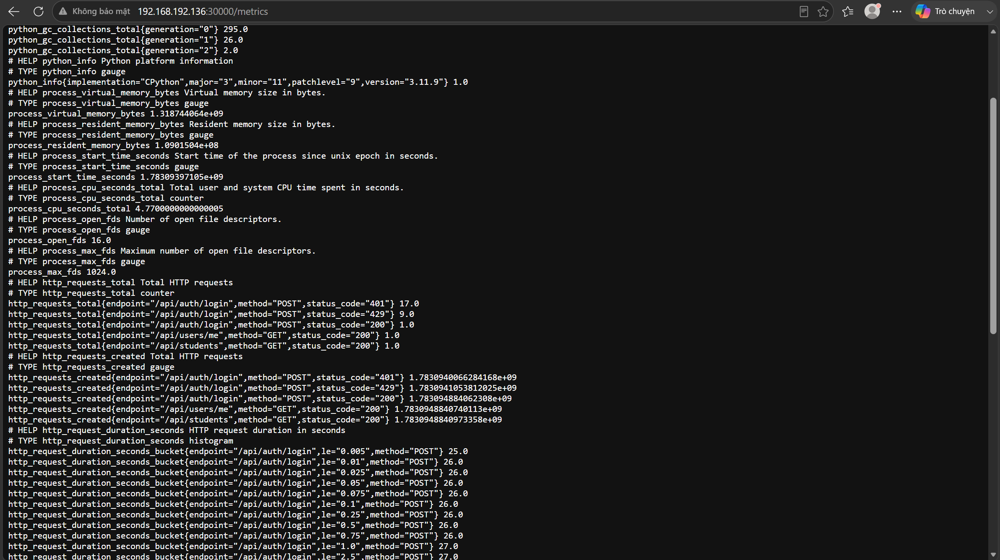

### Querying (PromQL)

In Grafana *Explore → Prometheus*:

```promql
# request rate per endpoint and status code
sum by (exported_endpoint, status_code) (rate(http_requests_total[5m]))

# number of 4xx/5xx responses over the last 24h
sum by (job, status_code) (increase(http_requests_total{status_code=~"4..|5.."}[24h]))

# 95th percentile latency per endpoint
histogram_quantile(0.95, sum by (le, exported_endpoint) (rate(http_request_duration_seconds_bucket[5m])))
```

> **`exported_endpoint`:** every target scraped through the ServiceMonitor already carries a target label `endpoint="http"` (the Service port name). The app's own `endpoint` label clashes with it, so Prometheus keeps the target label and renames the scraped one to **`exported_endpoint`**. Queries must therefore use `exported_endpoint`.

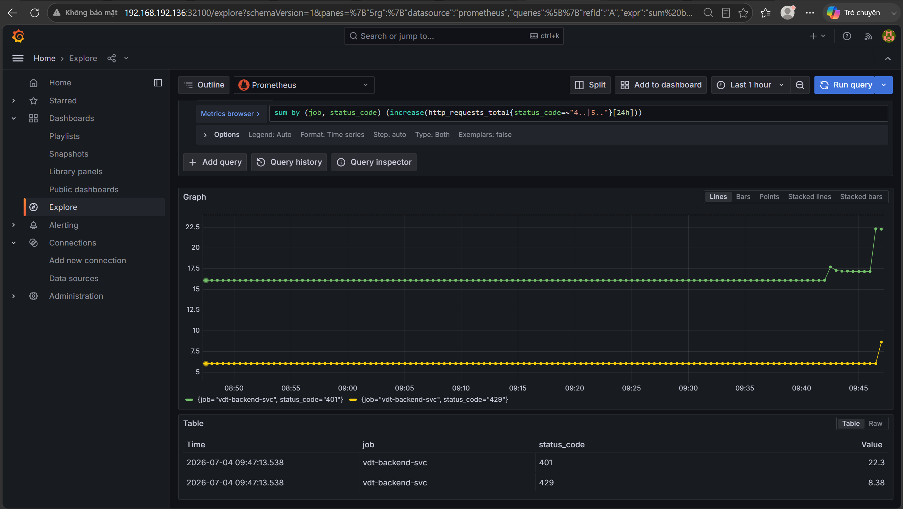

The `401` series come from failed logins. The `429` series come from the **rate limiter**: `slowapi` allows `5/minute` per client IP on `POST /api/auth/login` and on `POST /api/students`.

### Node metrics

kube-prometheus-stack also runs **node-exporter** on every node. It reads CPU, memory, disk and network figures directly from the OS. The *Node Exporter Full* dashboard (ID 1860), imported in [step 4](4-cloud-observability-setup.md#45-verify), shows them per node:

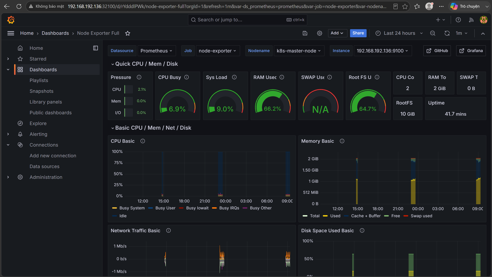

## 5.2 Logs

### Log format

The app logs to stdout and stderr. The root logger is configured in [configuration/telemetry.py](../app/src/backend/configuration/telemetry.py) with a format that includes the **current trace and span IDs**. A `logging.Filter` reads the active OpenTelemetry span and adds its IDs to every record:

```python
class TraceContextFilter(logging.Filter):
    def filter(self, record):
        span = trace.get_current_span()
        context = span.get_span_context()

        if context.is_valid:
            record.trace_id = f'{context.trace_id:032x}'   # 32 hex chars
            record.span_id = f'{context.span_id:016x}'     # 16 hex chars
        else:
            record.trace_id = '-'
            record.span_id = '-'

        return True
```

```python
# inside configure_tracing()
logging.getLogger('sqlalchemy.engine').setLevel(logging.INFO)   # log SQL statements too

formatter = logging.Formatter(
    '%(asctime)s %(levelname)s '
    '[trace_id=%(trace_id)s span_id=%(span_id)s] '
    '%(name)s - %(message)s'
)

root_logger = logging.getLogger()
if not root_logger.handlers:
    handler = logging.StreamHandler()
    handler.addFilter(TraceContextFilter())
    handler.setFormatter(formatter)
    root_logger.addHandler(handler)
else:
    for handler in root_logger.handlers:
        if not any(isinstance(f, TraceContextFilter) for f in handler.filters):
            handler.addFilter(TraceContextFilter())
        handler.setFormatter(formatter)

root_logger.setLevel(logging.INFO)
```

uvicorn's own access log is disabled (`--no-access-log` in the [Dockerfile](../app/src/backend/Dockerfile)). The metrics middleware writes an access line instead. That line runs inside the request, so it carries the trace context:

```python
logger.info(
    "client=%s method=%s endpoint=%s status=%d duration_ms=%.2f",
    request.client.host if request.client else "-",
    request.method, endpoint, status_code, duration * 1000
)
```

Resulting lines:

```text
2026-07-04 07:27:14,193 INFO [trace_id=2bdc2d06aa0b5198c839d83f1c4d81fa span_id=8abf084586e2ee46] root - client=10.244.1.26 method=POST endpoint=/api/auth/login status=429 duration_ms=2.01
2026-07-04 07:27:14,190 WARNING [trace_id=2bdc2d06aa0b5198c839d83f1c4d81fa span_id=8abf084586e2ee46] slowapi - ratelimit 5 per 1 minute (10.244.1.26) exceeded at endpoint: /api/auth/login
```

### Collection and querying (LogQL)

Promtail runs on every node. It tails `/var/log/pods/*` and attaches Kubernetes labels (`namespace`, `pod`, `container`, `app`, `job`, `node_name`, `stream`) before pushing to Loki.

In Grafana *Explore → Loki*:

```logql
# all backend logs
{namespace="default", app="vdt-backend"}

# warnings only (e.g. rate limiting)
{app="vdt-backend"} |= "WARNING"

# failed logins
{app="vdt-backend"} |= "endpoint=/api/auth/login" |= "status=401"

# every line of one request
{app="vdt-backend"} |= "trace_id=5013d895c65cb9ff956157bf6cdc846e"

# 5xx responses per minute
sum(count_over_time({app="vdt-backend"} |~ "status=5\\d\\d" [1m]))
```

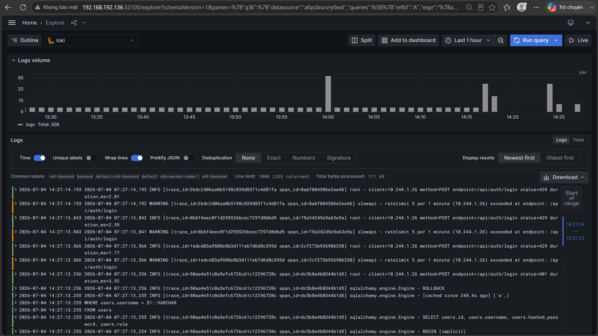

## 5.3 Traces

### Concepts

- **Trace:** the whole journey of one request through the system, identified by a unique **trace ID**.
- **Span:** one unit of work inside the trace, such as an incoming HTTP request, a DB connection or a SQL query. A span has its own **span ID**, a start and end time, attributes, and a reference to its **parent** span. Spans therefore form a tree, shown as a waterfall.
- **Context propagation:** the active trace and span IDs travel with the execution (and across services in HTTP headers). That is how logs and metrics recorded during a request can be tagged with the same IDs.

**OpenTelemetry (OTel)** is the vendor-neutral standard and SDK used to produce the spans. **Tempo** stores them, and Grafana queries them.

### Instrumentation

[configuration/telemetry.py](../app/src/backend/configuration/telemetry.py):

```python
OTEL_EXPORTER_OTLP_ENDPOINT = os.getenv('OTEL_EXPORTER_OTLP_ENDPOINT')   # http://tempo.observability...:4317


def configure_tracing():
    resource = Resource.create({'service.name': 'vdt-backend'})   # name shown in Tempo/Grafana
    provider = TracerProvider(resource=resource)

    exporter = OTLPSpanExporter(                                  # OTLP over gRPC to Tempo
        endpoint=OTEL_EXPORTER_OTLP_ENDPOINT,
        insecure=True
    )
    provider.add_span_processor(BatchSpanProcessor(exporter))     # export in batches, off the request path
    trace.set_tracer_provider(provider)

    SQLAlchemyInstrumentor().instrument(engine=async_engine.sync_engine)   # one span per DB call
    ...                                                                     # logging setup (5.2)


def instrument_app(app: FastAPI):
    FastAPIInstrumentor().instrument_app(app)                     # one server span per HTTP request
```

[main.py](../app/src/backend/main.py) calls both before the app serves traffic:

```python
configure_tracing()

app = FastAPI(lifespan=lifespan)

instrument_app(app)
```

Each request then produces a trace like this:

- `POST /api/auth/login`: the root *server* span, from FastAPI
- `http receive` / `http send`: ASGI messages
- `connect` and `SELECT`: *client* spans, from SQLAlchemy

### Querying (TraceQL)

In Grafana *Explore → Tempo*, use the *Search* builder or TraceQL:

```traceql
{ resource.service.name = "vdt-backend" }
{ resource.service.name = "vdt-backend" && span.http.status_code >= 400 }
{ resource.service.name = "vdt-backend" && duration > 500ms }
```

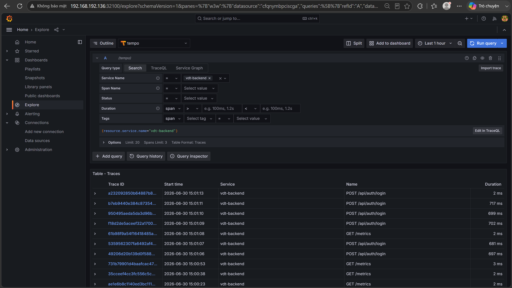

Trace of a failed login (`401`), showing the database spans:

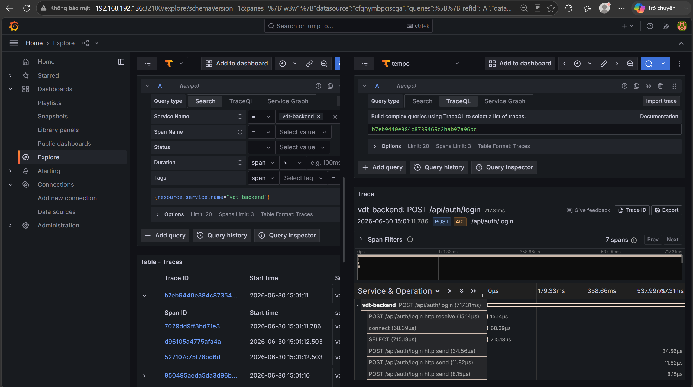

## 5.4 Linking traces and logs

Sections 5.1–5.3 set up each signal on its own. The next two sections connect them, following the links listed at the [top of this page](#5-metrics-logs-traces-and-their-correlation).

The logs already contain `trace_id=<32 hex>` ([5.2](#log-format)). The rest is Grafana datasource configuration. It is provisioned through `grafana.additionalDataSources` in [prometheus-stack-values.yaml](../cloud-observability/values/prometheus-stack-values.yaml), so it is versioned in Git and synced by ArgoCD rather than clicked together in the UI.

### Trace → Logs (`tracesToLogsV2` on the Tempo datasource)

```yaml
grafana:
  additionalDataSources:
    - name: Tempo
      type: tempo
      uid: tempo
      url: http://tempo.observability.svc.cluster.local:3200
      jsonData:
        tracesToLogsV2:
          datasourceUid: loki            # open logs in the Loki datasource below
          filterByTraceID: true          # add |= "<traceId>" to the query
          filterBySpanID: false
          customQuery: false
          spanStartTimeShift: "-5m"      # widen the time range around the span
          spanEndTimeShift: "5m"
          tags:
            - key: service.name          # span resource attribute ...
              value: app                 # ... mapped to the Loki label "app"
```

For a span of `vdt-backend`, the **Logs for this span** button runs a query equivalent to:

```logql
{app="vdt-backend"} |= "<traceId>"
```

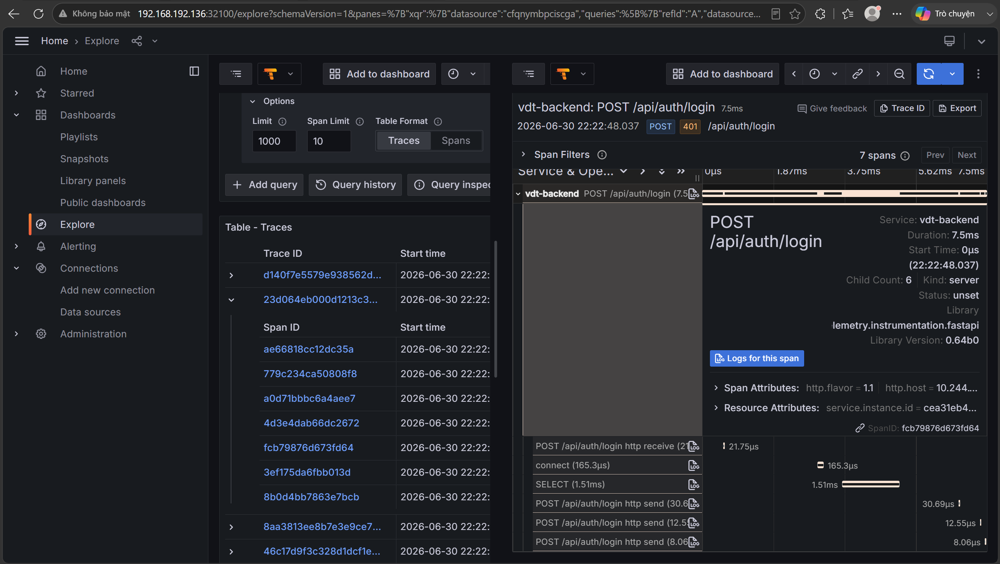

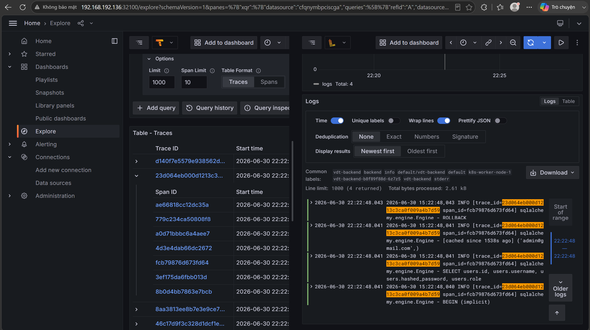

### Logs → Trace (`derivedFields` on the Loki datasource)

```yaml
    - name: Loki
      type: loki
      uid: loki
      url: http://loki.observability.svc.cluster.local:3100
      jsonData:
        derivedFields:
          - name: TraceID
            matcherRegex: "trace_id=([a-f0-9]{32})"   # capture group = the trace ID
            datasourceUid: tempo                      # internal link to the Tempo datasource
            url: "$${__value.raw}"                    # query = the captured value
```

Grafana runs the regex on every log line. A match becomes a **TraceID** field with a button that opens that trace in Tempo.

`$$` is an escape: Grafana's provisioning would otherwise treat `${...}` as an environment variable. The stored value is `${__value.raw}`.

## 5.5 Linking metrics to traces (exemplars)

An **exemplar** is a sample data point attached to a metric value. Here it is the `trace_id` of one real request that contributed to that counter increment or histogram bucket. On a graph, it shows which request caused a spike.

The chain has four parts.

**1. The app attaches the trace ID.** The trace ID is attached only when the current span is valid and sampled. It is passed as the second argument of `inc()` and `observe()` (see [5.1](#instrumentation)):

```python
def current_trace_exemplar():
    span = trace.get_current_span()
    context = span.get_span_context()

    if context.is_valid and context.trace_flags.sampled:
        return {'trace_id': f'{context.trace_id:032x}'}
    return None
```

**2. The app serves exemplars in OpenMetrics format.** Exemplars only exist in the OpenMetrics text format, so `/metrics` switches format based on the `Accept` header (see [5.1](#instrumentation)). Prometheus asks for OpenMetrics when it scrapes. Exemplars appear after `#`:

```bash
curl -s -H "Accept: application/openmetrics-text" http://192.168.192.136:30000/metrics | grep -A3 _bucket
```

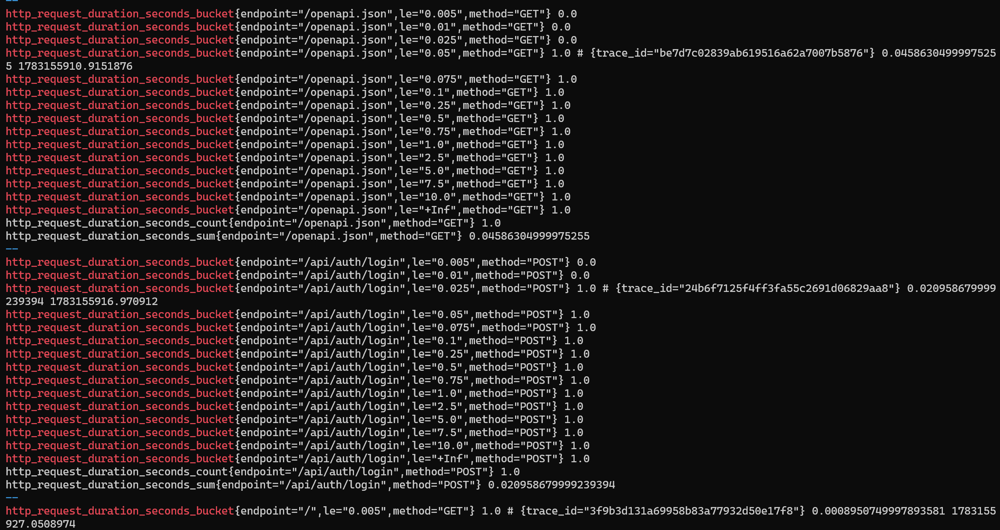

**3. Prometheus stores exemplars.** Exemplar storage is a feature flag, enabled in [prometheus-stack-values.yaml](../cloud-observability/values/prometheus-stack-values.yaml):

```yaml
prometheus:
  prometheusSpec:
    enableFeatures:
      - exemplar-storage
```

**4. Grafana links the exemplar label to Tempo.** The Prometheus datasource is generated by the chart's datasource sidecar, which is configured to turn the `trace_id` exemplar label into a link to the `tempo` datasource:

```yaml
grafana:
  sidecar:
    datasources:
      exemplarTraceIdDestinations:
        datasourceUid: tempo
        traceIdLabelName: trace_id
        urlDisplayLabel: "View Trace"
```

In *Explore → Prometheus*, turn on the **Exemplars** toggle. Exemplars are drawn as diamonds on top of the series:

```promql
sum by (job, exported_endpoint, status_code) (rate(http_requests_total[10m]))
```

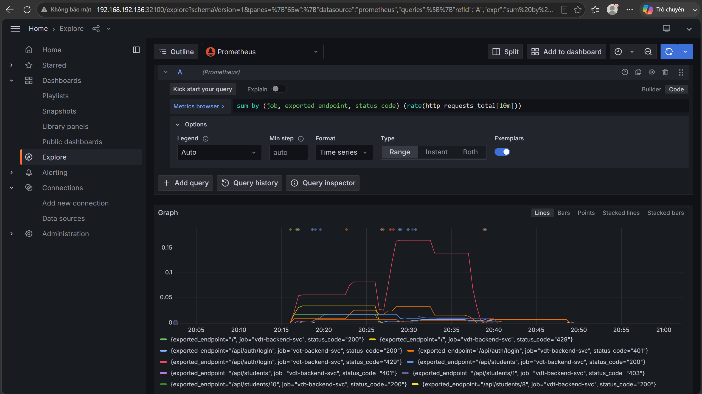

## 5.6 End to end: metric → trace → logs

1. The request-rate graph shows `401`s on `/api/auth/login`. Hovering an exemplar shows its `trace_id` and labels, and a **Query with Tempo** button:

   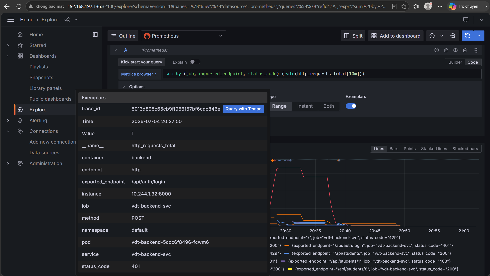

2. The button opens that exact trace (`POST /api/auth/login`, status `401`, with the `SELECT` on `users`):

   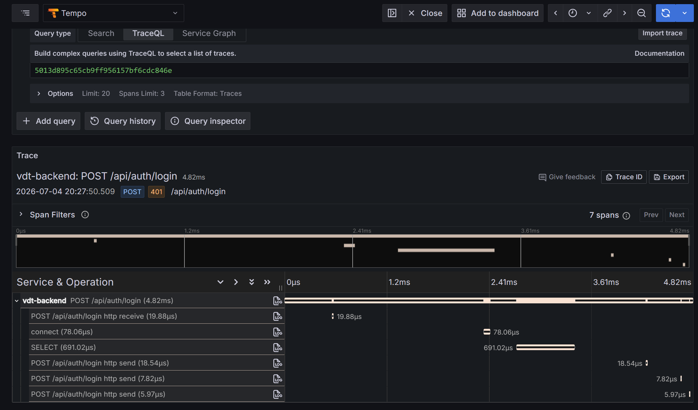

3. **Logs for this span** opens the log lines of the same request. Every line carries the same `trace_id`, and the access line confirms `status=401`:

   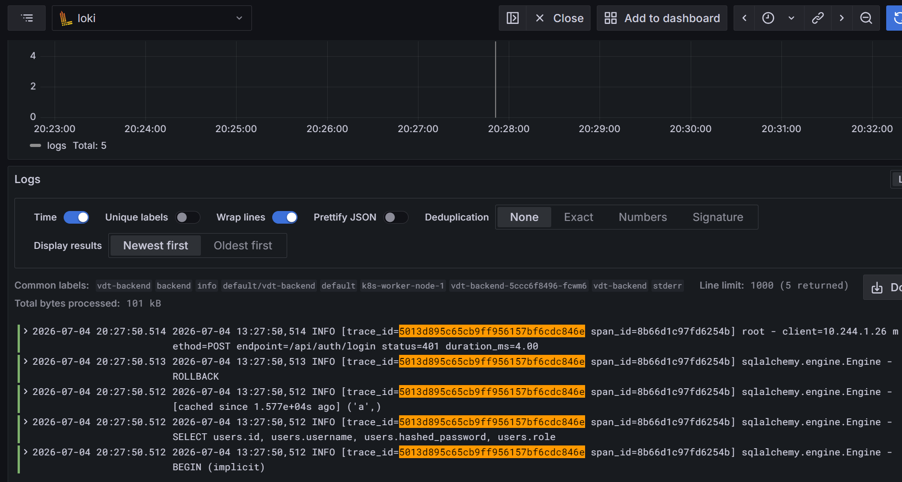

From a single spike on a metric graph, the exact request and its logs are reached in two clicks.

## 5.7 Future work

- Add code quality and security analysis to the pipeline (e.g. SonarQube).
- Collect metrics, logs and traces through one **OpenTelemetry Collector** instead of separate agents.
- Combine CI/CD with observability, for example by annotating Grafana dashboards with deployments, or by gating or rolling back releases on error rate.
